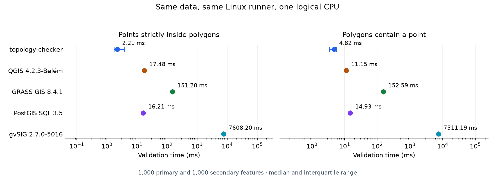

<picture>
  <source media="(prefers-color-scheme: dark)" srcset="docs/images/banner-dark.svg">
  
</picture>

<p align="center">
  <a href="https://github.com/alecsandrei/topology-checker/actions/workflows/build.yml"></a>
  <a href="https://github.com/alecsandrei/topology-checker/actions/workflows/build.yml"></a>
  <a href="https://github.com/alecsandrei/topology-checker/releases/latest"></a>
  <a href="LICENSE"></a>
  <br>
  <a href="https://pypi.org/project/topology-checker/"></a>
  <a href="https://pypi.org/project/topology-checker/"></a>
  <a href="https://pepy.tech/projects/topology-checker"></a>
  <br>
  <a href="https://crates.io/crates/topology-checker"></a>
  <a href="https://crates.io/crates/topology-checker"></a>
  <a href="https://crates.io/crates/topology-checker"></a>
</p>

<p align="center">
  <a href="https://alecsandrei.github.io/topology-checker/stable/">Documentation</a> ·
  <a href="https://alecsandrei.github.io/topology-checker/stable/install/">Install</a> ·
  <a href="https://alecsandrei.github.io/topology-checker/stable/cli/">CLI</a> ·
  <a href="https://alecsandrei.github.io/topology-checker/stable/rules/">Rules</a> ·
  <a href="https://alecsandrei.github.io/topology-checker/stable/web-app/">Web app</a> ·
  <a href="https://alecsandrei.github.io/topology-checker/stable/qgis-plugin/">QGIS plugin</a> ·
  <a href="https://alecsandrei.github.io/topology-checker/stable/rustgis-plugin/">RustGIS plugin</a> ·
  <a href="https://alecsandrei.github.io/topology-checker/stable/python-usage/">Python usage</a> ·
  <a href="https://alecsandrei.github.io/topology-checker/stable/python-api/">Python API</a> ·
  <a href="https://docs.rs/topology-checker-core/latest/topology_checker_core/">Rust API</a>
</p>

# topology-checker

topology-checker checks map data for duplicate points, gaps, overlaps, and disconnected lines. Use it with Python, the command line, the local web app, or as a [QGIS](https://alecsandrei.github.io/topology-checker/stable/qgis-plugin/) or [RustGIS](https://github.com/opengeos/RustGIS) plugin.



See the [measurements](benchmarks/gis/results/README.md) and [benchmark methodology](benchmarks/gis/README.md).

## Python API

```sh
uv add 'topology-checker[geopandas]'
```

```python
from topology_checker import Rule, Topology

topology = Topology(tolerance=0.001)
topology.add_rule(Rule.MUST_NOT_HAVE_DANGLES, roads_gdf)
errors = topology.validate().to_geodataframe()
```

[More Python examples](python/README.md), the [usage guide](https://alecsandrei.github.io/topology-checker/stable/python-usage/) and the [API reference](https://alecsandrei.github.io/topology-checker/stable/python-api/).

## CLI

Requires Rust 1.88 or newer.

```sh
cargo install topology-checker --locked
```

```sh
topology-checker rules
topology-checker --json rules
topology-checker drivers --read --write

topology-checker line must-not-have-dangles roads.gpkg --layer roads -o errors.gpkg
topology-checker line must-not-overlap-with roads.gpkg --other rivers.shp -o overlaps.gpkg
topology-checker polygon must-not-have-gaps parcels.geojson --tolerance 0.001 -o gaps.gpkg
topology-checker --json point must-not-overlap points.geojson
topology-checker point must-be-covered-by-lines stops.geojson --other routes.gpkg
topology-checker polygon must-contain-one-point parcels.gpkg --other addresses.gpkg
topology-checker line must-not-intersect-polygons roads.gpkg --other buildings.gpkg
topology-checker --overwrite --driver GPKG line must-not-have-dangles roads.gpkg -o errors.gpkg

topology-checker utilities merge-lines roads.gpkg --layer roads -o merged.gpkg
topology-checker utilities explode-lines roads.gpkg --layer roads -o segments.gpkg
topology-checker line must-not-have-dangles --help
```

`-o` writes `errors_point`, `errors_line` and `errors_polygon` layers with `violation_id`, `rule`, `error_type` and the origin and destination layer, FID and part of each violation. The web app's dataset exports use the same columns. See [CLI](https://alecsandrei.github.io/topology-checker/stable/cli/) and [Rules](https://alecsandrei.github.io/topology-checker/stable/rules/).

`topology.toml`:

```toml
tolerance = 0.001

[layers]
roads = { path = "city.gpkg", layer = "roads" }
rivers = { path = "rivers.shp" }
parcels = { path = "city.gpkg", layer = "parcels" }
addresses = { path = "addresses.gpkg" }

[[rules]]
rule = "line/must-not-have-dangles"
layer = "roads"

[[rules]]
rule = "line/must-not-overlap-with"
layer = "roads"
other = "rivers"

[[rules]]
rule = "polygon/must-not-have-gaps"
layer = "parcels"

[[rules]]
rule = "polygon/must-contain-one-point"
layer = "parcels"
other = "addresses"
```

```sh
topology-checker --json validate topology.toml -o errors.gpkg
```

## QGIS plugin

The Topology Rules plugin adds a Processing tool for each rule and a panel where you queue several rules, run them in one pass and browse the errors. It runs the CLI (0.2.0 or newer), so install that first, then the plugin in **Plugins > Manage and Install Plugins** with experimental plugins shown. See [QGIS plugin](https://alecsandrei.github.io/topology-checker/stable/qgis-plugin/).

### Plugin development

Lint needs no QGIS: in `qgis_plugin/`, `uv sync`, then `uv run ruff check .` and `uv run ruff format --check .`.

pyright and the tests need a QGIS Python. With Docker, as CI does (`--platform` makes it work on ARM machines too):

```sh
docker run --rm --platform linux/amd64 -v "$PWD":/src -w /src rust:1 cargo build --release -p topology-checker --target-dir target/linux
docker run --rm --platform linux/amd64 -v "$PWD":/src -w /src/qgis_plugin -e TOPOLOGY_CHECKER=/src/target/linux/release/topology-checker -e UV_PROJECT_ENVIRONMENT=/tmp/venv qgis/qgis:stable \
  bash -c 'pip install --break-system-packages uv && uv venv /tmp/venv --system-site-packages --python /usr/bin/python3 && uv sync --locked && uv run pyright && uv run pytest'
```

Tests that need the tool skip without `TOPOLOGY_CHECKER`. With a local QGIS, run `cargo build --release` and point `TOPOLOGY_CHECKER` at `target/release/topology-checker`:

- macOS (checked), with your QGIS app, e.g. `/Applications/QGIS-final-4_2_2.app`: `uv pip install --target /tmp/qgis-pytest pytest pytest-qgis`, then `APP=/Applications/QGIS-final-4_2_2.app/Contents; PYTHONHOME=$APP/Frameworks PYTHONPATH=/tmp/qgis-pytest QT_QPA_PLATFORM=offscreen TOPOLOGY_CHECKER=<absolute path to target/release/topology-checker> $APP/MacOS/python3.12 -m pytest`. pyright does not run on that Python; use Docker.
- Linux and Windows (not checked here): `uv venv --system-site-packages --python <QGIS's python>` (`/usr/bin/python3`, or `python` in the OSGeo4W shell), `uv sync --locked`, then `uv run pytest` and `uv run pyright`.

The modules are listed in `topology_rules/__init__.py`.

## Rust API

`Cargo.toml` (update the path):

```toml
[dependencies]
topology-checker-core = { path = "/path/to/topology-checker/crates/core" }
```

```rust
use topology_checker_core::{
    geo::{Geometry, line_string},
    Error, Layer, Rule, Topology, ViolationKind,
};

fn main() -> Result<(), Error> {
    let mut topology = Topology::new(0.001)?;
    let roads = topology.add_layer(Layer::from_features("roads", [
        (41, Geometry::from(line_string![(x: 0., y: 0.), (x: 1., y: 0.)])),
        (92, Geometry::from(line_string![(x: 1., y: 0.), (x: 2., y: 0.)])),
    ]));
    topology.add_rule(Rule::LineMustNotHaveDangles, roads, None)?;

    let report = topology.validate()?;
    assert!(!report.is_valid());
    assert_eq!(report.violation_count(), 2);
    assert!(report.violations().all(|v| v.kind == ViolationKind::Dangle));
    Ok(())
}
```

## Local web app

```sh
npm ci --prefix web
npm run build --prefix web
cargo run -p topology-checker-web --release --locked
```

Open <http://127.0.0.1:8080>, or pass `--port` (or set `TOPOLOGY_WEB_PORT`) to use another port. Release builds embed the frontend, so `target/release/topology-checker-web` runs on its own. Workspaces idle for four hours are discarded. See [Web app](https://alecsandrei.github.io/topology-checker/stable/web-app/).

The TypeScript API types in `web/src/generated` are generated from the server by `cargo test`.

## RustGIS plugin

topology-checker is also a [RustGIS](https://github.com/opengeos/RustGIS) plugin, with a tool for each rule. Install `topology-checker-<version>.rgplugin` from the [latest release](https://github.com/alecsandrei/topology-checker/releases/latest) with Plugin Manager › **Install from File**. See [RustGIS plugin](https://alecsandrei.github.io/topology-checker/stable/rustgis-plugin/).
