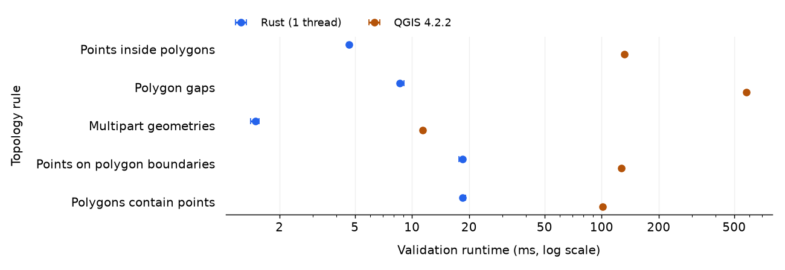

# topology-checker

topology-checker checks map data for duplicate points, gaps, overlaps, and disconnected lines. Use it with Python, the command line, or the local web app.



## Python API

```sh
uv add 'topology-checker[geopandas]'
```

```python
from topology_checker import Rule, Topology

topology = Topology(tolerance=0.001)
topology.add_rule(Rule.MUST_NOT_HAVE_DANGLES, roads_gdf)
errors = topology.validate().to_geodataframe()
```

[More Python examples](python/README.md), [usage guide](docs/python-usage.md), and [manual release guide](docs/python-release.md).

## CLI

Requires Rust 1.88 or newer. Install from the repository root:

```sh
cargo install --path crates/cli --locked
```

```sh
topology-checker rules
topology-checker --json rules
topology-checker drivers --read --write

topology-checker line must-not-have-dangles roads.gpkg --layer roads -o errors.gpkg
topology-checker line must-not-overlap-with roads.gpkg --other rivers.shp -o overlaps.gpkg
topology-checker polygon must-not-have-gaps parcels.geojson --tolerance 0.001 -o gaps.gpkg
topology-checker --json point must-not-overlap points.geojson
topology-checker point must-be-covered-by-lines stops.geojson --other routes.gpkg
topology-checker polygon must-contain-one-point parcels.gpkg --other addresses.gpkg
topology-checker line must-not-intersect-polygons roads.gpkg --other buildings.gpkg
topology-checker --overwrite --driver GPKG line must-not-have-dangles roads.gpkg -o errors.gpkg

topology-checker utilities merge-lines roads.gpkg --layer roads -o merged.gpkg
topology-checker utilities explode-lines roads.gpkg --layer roads -o segments.gpkg
topology-checker line must-not-have-dangles --help
```

`-o` writes `errors_point`, `errors_line` and `errors_polygon` layers with `violation_id`, `rule`, `error_type` and the origin and destination layer, FID and part of each violation. The web app's dataset exports use the same columns.

`topology.toml`:

```toml
tolerance = 0.001

[layers]
roads = { path = "city.gpkg", layer = "roads" }
rivers = { path = "rivers.shp" }
parcels = { path = "city.gpkg", layer = "parcels" }
addresses = { path = "addresses.gpkg" }

[[rules]]
rule = "line/must-not-have-dangles"
layer = "roads"

[[rules]]
rule = "line/must-not-overlap-with"
layer = "roads"
other = "rivers"

[[rules]]
rule = "polygon/must-not-have-gaps"
layer = "parcels"

[[rules]]
rule = "polygon/must-contain-one-point"
layer = "parcels"
other = "addresses"
```

```sh
topology-checker --json validate topology.toml -o errors.gpkg
```

## Rust API

`Cargo.toml` (update the path):

```toml
[dependencies]
topology-checker-core = { path = "/path/to/topology-checker/crates/core" }
```

```rust
use topology_checker_core::{
    geo::{Geometry, line_string},
    Error, Layer, Rule, Topology, ViolationKind,
};

fn main() -> Result<(), Error> {
    let mut topology = Topology::new(0.001)?;
    let roads = topology.add_layer(Layer::from_features("roads", [
        (41, Geometry::from(line_string![(x: 0., y: 0.), (x: 1., y: 0.)])),
        (92, Geometry::from(line_string![(x: 1., y: 0.), (x: 2., y: 0.)])),
    ]));
    topology.add_rule(Rule::LineMustNotHaveDangles, roads, None)?;

    let report = topology.validate()?;
    assert!(!report.is_valid());
    assert_eq!(report.violation_count(), 2);
    assert!(report.violations().all(|v| v.kind == ViolationKind::Dangle));
    Ok(())
}
```

## Local web app

```sh
npm ci --prefix web
npm run build --prefix web
cargo run -p topology-checker-web --release --locked
```

Open <http://127.0.0.1:8080>, or pass `--port` (or set `TOPOLOGY_WEB_PORT`) to use another port. Release builds embed the frontend, so `target/release/topology-checker-web` runs on its own. Workspaces idle for four hours are discarded.

The TypeScript API types in `web/src/generated` are generated from the server by `cargo test`.
